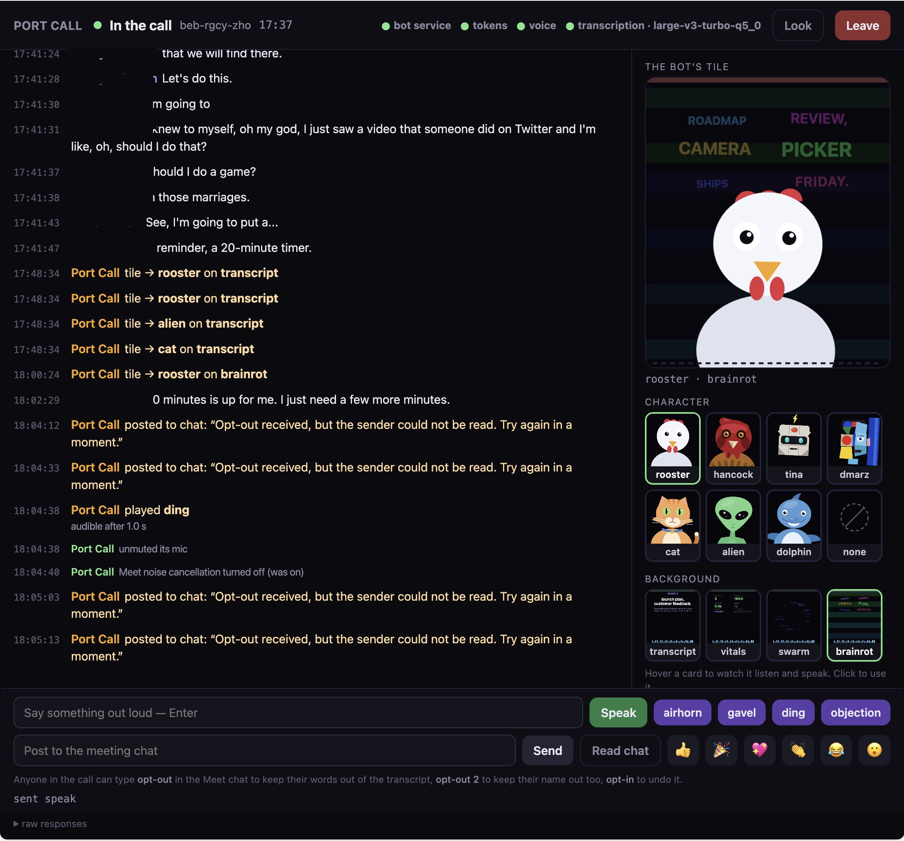

# Port Call

**A Google Meet participant you control from your laptop.** It joins your meeting, transcribes who
said what, and acts in the call: it speaks in its own voice, plays sound effects, posts and reads
chat, sends reactions, and shows a live animated tile as its camera. Everything runs on your
machine; the only thing it talks to is Google Meet.

Built on [Vexa](https://github.com/Vexa-ai/vexa) (Apache-2.0), which handles joining and audio
capture. Port Call adds the acting, the console, local transcription, and a long list of
[things that only work once you know why the obvious way doesn't](docs/findings.md).

<p align="center">
  
</p>

<p align="center"><em>The console in a call. Left: the room's words and the bot's deeds, one timeline. Right: the tile the bot shows as its camera. Bottom: the strings.</em></p>

## What it does

| In the call | How |
|---|---|
| Joins as a participant | knocks like a guest; you admit it |
| Transcribes, with speaker names | Whisper on your machine; names from whose tile is lit |
| Speaks | type a line, the bot says it aloud |
| Sound effects | `!airhorn`, `!gavel`, `!ding`, `!objection`, or drop your own `.wav` in `shims/sfx/` |
| Chat | posts to the meeting chat and reads it |
| Reactions | 👍 🎉 💖 👏 😂 😮 through Meet's own picker |
| Camera | a character (rooster, cat, alien, dolphin, …) over a background (live captions, pipeline numbers, the room's words in orbit), drawn live |
| Presents | shares that same tile as a screen |
| Opt-out | anyone can type `opt-out` in the chat and their words stop being transcribed; `opt-out 2` keeps their name out too; `opt-in` undoes it |

Everything the tile shows is derived from what is really happening: the "listening" animation
follows transcript recency, the beak opens on the actual level of the voice audio. It cannot look
healthy when the pipeline isn't.

## Quick start

You need **Docker** (Docker Desktop, OrbStack, or Docker Engine), **Python 3.10+**, and
**whisper.cpp** for transcription on your machine (`brew install whisper-cpp` on macOS; elsewhere
build [whisper.cpp](https://github.com/ggml-org/whisper.cpp) and put `whisper-server` on your
PATH). Windows works through WSL.

```bash
git clone https://github.com/amiller/port-call.git && cd port-call
./pc doctor         # says what is missing and how to install it
./pc up             # first run: copies .env.example to .env, builds the bot image (a few minutes)
```

Then open **http://localhost:8090**, paste a Meet link, press **Join**. The bot knocks; admit it
in Meet like any guest. From that moment the timeline fills, and the dock at the bottom is yours.

The same things from a terminal:

```bash
./pc join https://meet.google.com/abc-defg-hij
./pc say "Hello everyone"
./pc say "!gavel"
./pc chat "Hi from the bot"
./pc camera "ON AIR" alien brainrot      # headline, character, background
./pc react 🎉
./pc stop
./pc down                                # stop the stack
```

### Which meetings it can join

As shipped, the bot joins as a **guest**, which works for any meeting whose host admits guests,
and for open rooms. **Calendared meetings on personal Google accounts wall out guests** behind a
sign-in; for those the bot needs a Google account of its own, signed in once by hand through the
noVNC view of its desktop. What that involves, and what must never leave your machine, is in
[docs/credentials.md](docs/credentials.md).

### Where the data goes

Nowhere. The stack binds to `127.0.0.1` only. Transcription is Whisper on your machine, the voice
is Piper inside a container, transcripts sit in a Postgres container, and the console has no login
because nothing outside your laptop can reach it. Google sees a participant, the same as any
attendee. The one cloud option, transcription through near.ai, is off unless you turn it on in
`.env`, and `.env.example` says what leaves the machine when you do.

## Configuration

All of it is in `.env`, copied from [`.env.example`](.env.example) on the first `./pc up`.

| Setting | What it is |
|---|---|
| `OWNER_NAME`, `OWNER_EMAIL` | the account the stack mints tokens for; transcripts belong to it |
| `COMPOSE_PROJECT_NAME` | names the containers and volumes; pick once |
| `VEXA_GW_PORT`, `VEXA_UI_PORT`, `VEXA_VNC_PORT` | host ports (loopback only) |
| `TRANSCRIPTION_SERVICE_URL` | Whisper on your machine by default; any OpenAI-compatible `/v1/audio/transcriptions` works |
| `PIPECAT_URL` | utterance cutting and end-of-turn detection on your machine; comment out for the bot's built-in lane |
| `NEAR_API_KEY`, `COMPOSE_PROFILES=transcribe` | the cloud alternative; audio leaves the machine |
| `RECORDING_ENABLED` | off; there is no store wired for recordings yet |
| `TTS_ENGINE` | `piper` (natural) or `espeak` (robotic, no dependencies) |

`./pc model` lists Whisper models and switches between them; the console offers the same dropdown.

## How it works

```
console (board.py :8090)  ──►  gateway :8056  ──►  bot process (Node, one per meeting)  ──►  Chromium ──► Google Meet
                                                     │  speak → TTS → PulseAudio null sink → the bot's mic
                                                     │  camera / present → canvas → patched getUserMedia / getDisplayMedia
                                                     │  chat / reactions / opt-out → Meet's DOM
                                                     ▼
                              transcripts  ◄──  Pipecat (utterances, turns)  ◄──  Whisper on your machine
```

One bot process per meeting owns the browser, so everything that touches Meet's page lives there.
Everything else is decoupled: acts go in over redis, transcripts come out over redis, and the
console is one page that reads the bot's own log, so it cannot report a sound that never played.

The bot's source lives in `patches/` and is applied over upstream Vexa at image build. The copy
that runs is bind-mounted from `live/`, so an edit followed by `./hotswap.sh` lands on the next
act in about ten seconds, with the bot still in the call.

## Developing and testing

```bash
./pc bench          # everything that needs no meeting: image build, audio, camera, surfaces vs a Meet-shaped DOM
./e2e.sh <code>     # the same surfaces against a real, open Meet room, unattended
./hotswap.sh        # recompile the bot in place; the next act runs the new code
```

The edit loop, the `patches/` ↔ `live/` discipline, hot-swap semantics, and the rule that a mock
is built from a dump of real Meet and never from assumption are in [docs/dev.md](docs/dev.md).
Running `e2e.sh` needs a permanent open room, which `lab-room.py` mints through the Meet API with a
Google Cloud project of yours; that is only for the test ladder, not for using the bot.

Most of this repo was written by agents, under one rule about what they may be assigned: work
whose success the agent can observe without a meeting. [docs/swarm.md](docs/swarm.md) is the
honest account of what that produced and what is still done by hand.

## The documents

- [docs/findings.md](docs/findings.md) — what real Meet does that the obvious approach doesn't survive
- [docs/credentials.md](docs/credentials.md) — the bot's Google account, and what never ships
- [docs/dev.md](docs/dev.md) — the edit loop and the test ladder
- [docs/operations.md](docs/operations.md) — running it somewhere other than a laptop, including a confidential VM
- [docs/roadmap.md](docs/roadmap.md) — where this is going; open work is in [issues](https://github.com/amiller/port-call/issues)

## Known gaps

- A second automated participant, to verify what the bot cannot see about itself, is blocked by
  Google's "You can't join this video call" interstitial.
- Transcription cannot prove itself in an empty room: zero segments is a legitimate pass.
- A new camera character or background needs a fresh bot: Meet keeps publishing the video track
  it first acquired.
- Opting out cuts a person's words at publish; Whisper still hears them. Words spoken before the
  opt-out stay.

## License and attribution

Apache-2.0. Vexa is Apache-2.0 and is used here as a base image with patches; see
[NOTICE](NOTICE).
